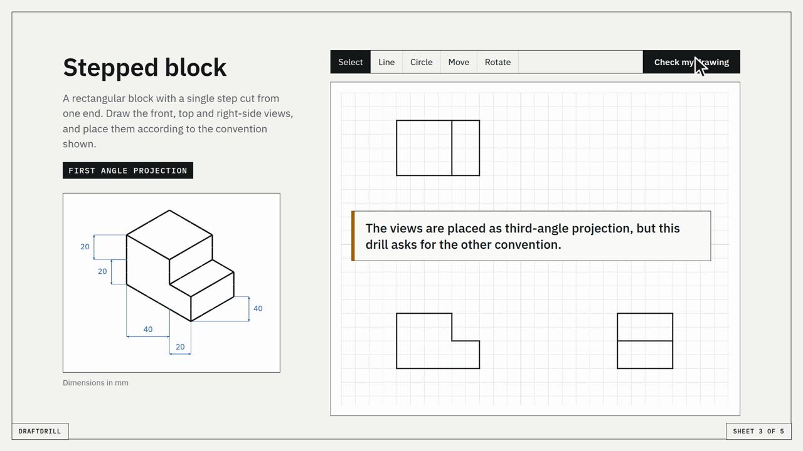
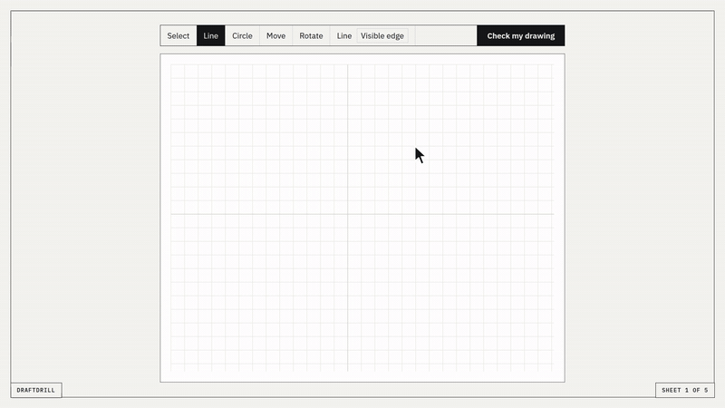
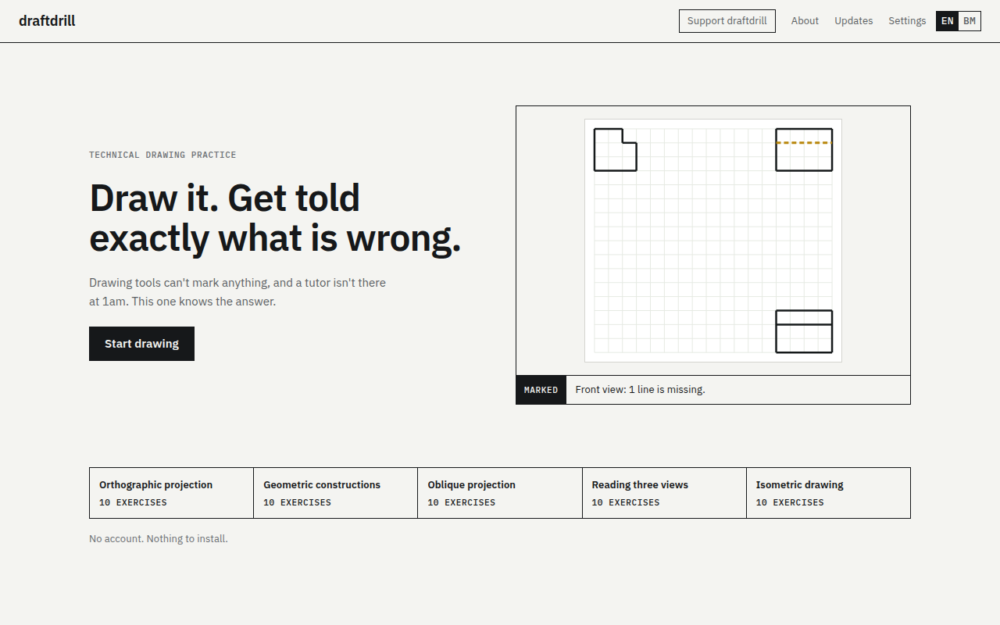
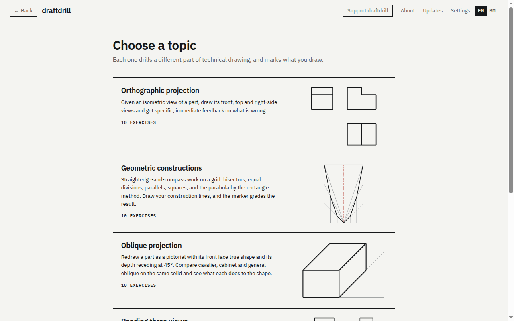
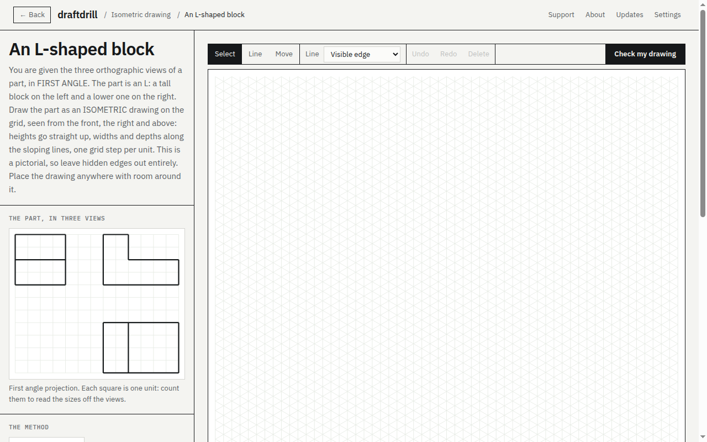
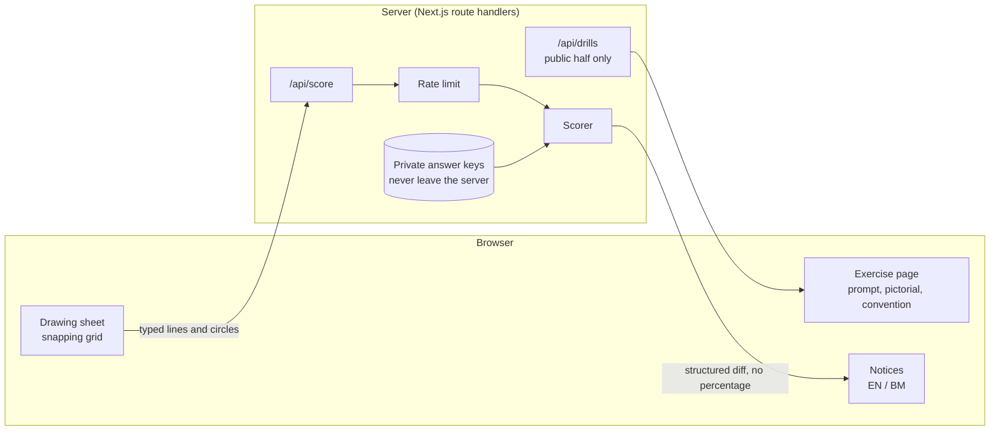
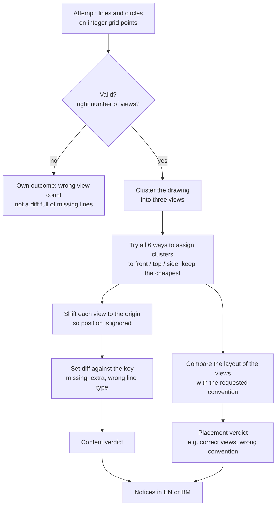
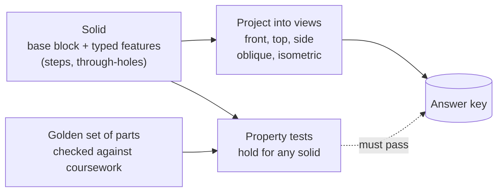

# draftdrill

**Practise technical drawing and get marked.** You draw on a snapping grid. draftdrill knows the answer and tells you exactly what you got wrong.

**Live: [draftdrill.vercel.app](https://draftdrill.vercel.app)** · free, no ads, no account · English and Bahasa Melayu

[Watch the 23-second launch video](media/draftdrill-launch.mp4)

> **This repository is a showcase, not the source.** The code is closed because it contains the answer to every exercise. A public repo would hand out the answer key, so the code stays private and this page explains how it works instead.

---

## What it does

Technical drawing is hard to practise alone. Drawing software lets you draw but cannot say whether a drawing is right. A course can say so, but only through a person, on a schedule. draftdrill sits in the gap: instant, specific marking at 1am before an assessment.

It doesn't say "78% similar". It says things like:

- *"Front view: 1 line is missing."*
- *"The views are placed as third-angle projection, but this drill asks for the other convention."*
- *"Every view is correct, and they are placed correctly."*

### Five topics, 50 exercises

| Topic | What you do |
|---|---|
| Orthographic projection | Given a dimensioned isometric view, draw the front, top and side views |
| Geometric constructions | Build a parabola by the rectangle method, and other straightedge constructions |
| Reading three views | Given the three views, rebuild the solid they describe |
| Oblique projection | Draw cavalier, cabinet and general oblique on the same solid |
| Isometric drawing | Given the three views, draw the part on isometric grid paper |

Every topic is in **English and Bahasa Melayu**, because Malaysian schools teach technical drawing (*Lukisan Kejuruteraan*) in BM. The BM terms come from the national textbooks.

  
  

  

---

## How it works

### System overview

Every exercise is split in two. The **public half** (the pictorial, the grid size, the convention, the prompt) is sent to the browser. The **private half**, the answer key, is read only inside the scoring route. Anything the browser can check, the browser can read, and obfuscation or hashing doesn't change that. So the key never reaches the client, and a test fails if browser code imports anything that holds one.

The known cost: useful feedback leaks the key slowly, because enough submissions reconstruct an answer. Rate limiting bounds that. It's fine for a practice tool, where the only person cheating is the one cheating themselves. It would not be fine for graded assessment.

### How a drawing is marked

A few choices that shape the feedback:

- **Views are identified by their content, not their position.** Position is exactly what the projection convention governs. If the scorer guessed the view from where you drew it, it would agree with whatever layout you chose and could never tell you that you laid it out wrongly. Six permutations are cheap to check.
- **Content and placement get separate verdicts.** A perfectly drawn view ten units too far right is a placement mistake, not a drawing mistake. Mixing them would give feedback that is both false and useless.
- **A wrong line style is one mistake, not two.** A hidden edge drawn solid is reported as "wrong line style", not "one line missing and one extra". The second reading is technically true and teaches nothing, and it describes the most common error in the subject.
- **There is no overall score.** "72% correct" tells a student nothing about what to fix, so the scorer returns a structured diff and the interface describes it in words.

### Where the answer keys come from

Keys are generated from a model of the part, not typed by hand. Hand-written keys would be a content grind and a source of wrong keys, and a wrong key means the app confidently teaches the wrong drawing. The parts are modelled as a base block plus typed features, how parametric CAD works. A general boolean engine for solids was considered and rejected as a known-hard problem that would produce nothing a student sees.

Two layers guard against a wrong key. Property tests assert things that must hold for any solid (symmetric solids give symmetric views, a through-hole gives exactly one circle and two pairs of bore lines). A golden set of parts is checked against technical drawing coursework that predates the project.

---

## The decision that shaped the roadmap

The marker works on integer grid points, so before building any topic I measured whether its correct answer even lands on the grid:

| Construction | Share of answers that land on the grid |
|---|---|
| Parabola, rectangle method | all, exactly |
| Oblique projection, all three types | 27,104 of 27,104 corners |
| Isometric drawing on isometric grid paper | every line, 0 mismatches over 3,030 parts |
| Tangent from an external point to a circle | **0 of 162** configurations |
| A line at exactly 60° on squared paper | none (nearest is 60.2551°) |
| Rotating a drawing by anything other than 90° | **4 of 360** whole degrees |

That check ran before the design, and it sorted every candidate topic. Tangents and ellipses can't be drawn on a snapping grid at all, so they wait for a tolerance-based marking mode. Isometric drawing was on that list until a second grid, isometric paper, made all of its lines exact. And the rotate tool offers four angles rather than eight, because the other four would quietly damage a student's drawing when rounded back to the grid.

---

## Decisions I'd defend

- **Marking is the product, topics are content.** The scorer diffs typed lines and circles and doesn't care what they depict, so a new topic is content rather than a rewrite.
- **No database in v1.** Exercises are files. Attempts don't need saving for the tool to teach, so a schema and migrations would have been a cost with no student benefit.
- **Both projection conventions.** First-angle dominates Europe and Asia, third-angle dominates the US and Japan. Neither is correct, so the app teaches the difference rather than picking a side.
- **Read the page as a student.** The bugs that mattered most were in the words, not the logic: a hint that contradicted its own answer, a prompt that described points off the grid. A green test suite missed them and opening the page caught them.
- **Premise check before design.** I searched for existing automated drills first and found drawing tools that can't mark and courses that mark by hand. I also checked a candidate that looked better (ER-diagram marking) and found it was far more crowded, so I didn't build it.

---

## Facts

| | |
|---|---|
| Live since | 15 September 2026 |
| Topics / exercises | 5 / 50 |
| Languages | English, Bahasa Melayu |
| Tests | 691 |
| Stack | Next.js 16 (App Router), React 19, TypeScript, Tailwind CSS 4, deployed on Vercel |
| Database | none |
| Accounts / ads | none |

## What it doesn't do

It doesn't assess draughtsmanship. Input snaps to a grid, so it tests whether you understand the drawing, not whether you can strike a clean line. That narrowing is deliberate: it makes the marking honest and specific rather than fuzzy.

The one test still outstanding is the one that matters most: a student who has never seen the app completes a drill cold and agrees the feedback is right. If you teach or study technical drawing and would try it, I'd like to hear how it goes.

---

## About

Built by **Adam Afzainizam**, a software engineering diploma student in Malaysia.
[GitHub](https://github.com/adamafzainizam) · [LinkedIn](https://www.linkedin.com/in/adam-afzainizam/) · m.adamafzainizam@gmail.com

## License

All rights reserved. This repository contains documentation and media only. The draftdrill source code is private.
